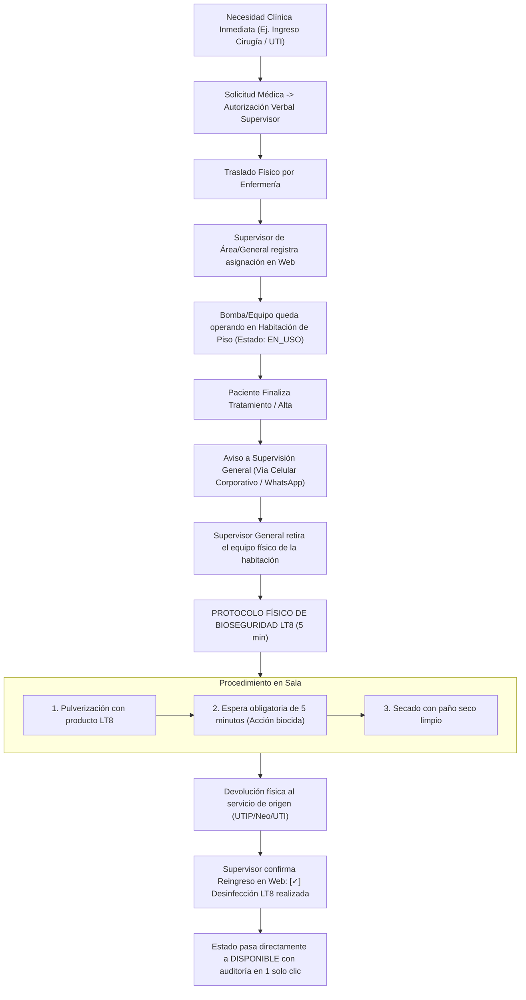
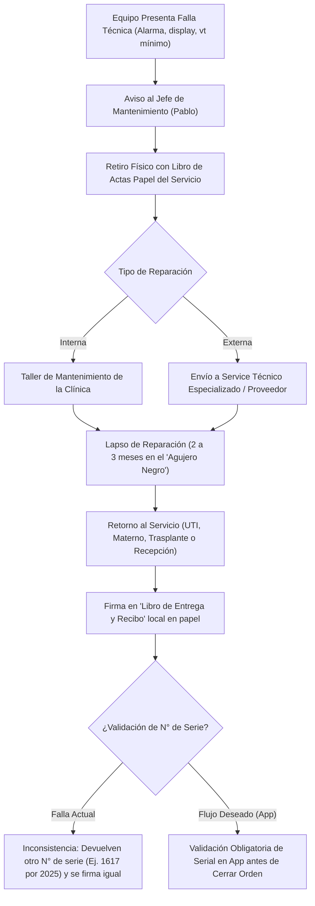
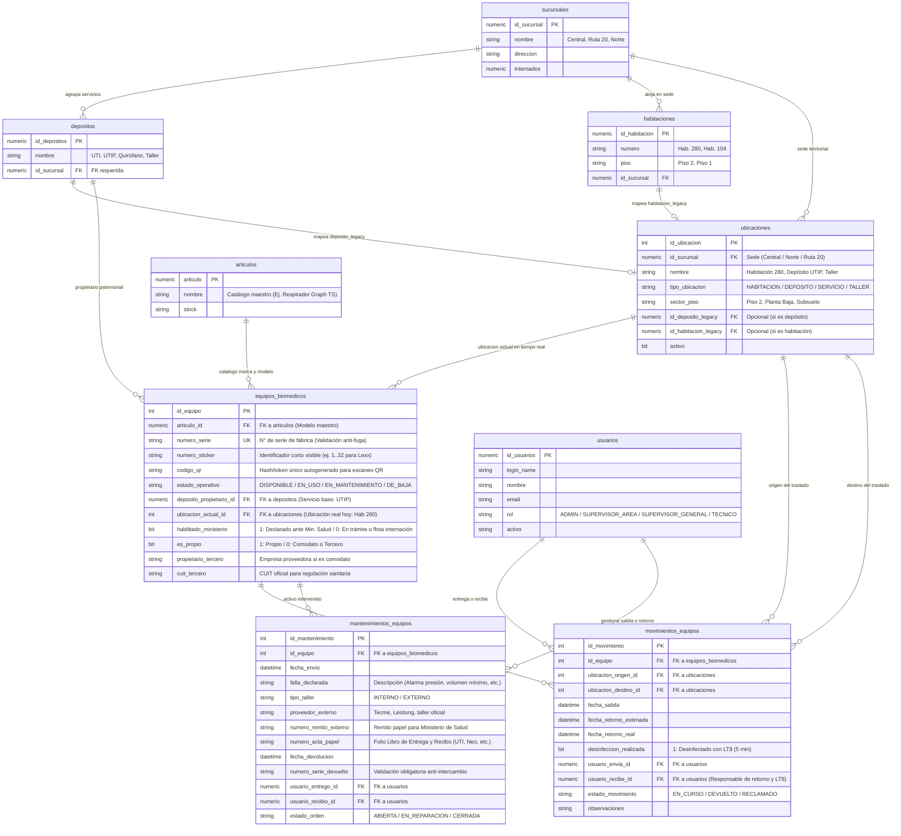

# Documento de Requerimientos de Producto (PRD)
## Product Discovery - Gestión de Equipamiento y Trazabilidad Clínica Privada Vélez Sarsfield

* **Institución:** Clínica Privada Vélez Sarsfield (Córdoba)
* **Proyecto:** Sistema de Gestión y Trazabilidad de Equipamiento Biomédico
* **Relevamiento y Discovery:** Martín Sciarra (Desarrollador / Pasante)
* **Entrevistada:** Alejandra (Responsable de Gestión y Control de Equipamiento)
* **Fecha:** Octubre 2026

---

## 1. Resumen Ejecutivo y Diagnóstico Situacional

La Clínica Privada Vélez Sarsfield experimenta una severa pérdida de visibilidad y control operativo sobre su parque de equipamiento biomédico crítico (respiradores, bombas de infusión, electrocardiógrafos, cardiodesfibriladores). 

Actualmente, el control se sustenta en:
1. Una **planilla operativa viva** de seguimiento en terapia intensiva (`Planilla de respiradores.xlsx`) con anotaciones manuales informales de fallas.
2. Una **planilla oficial ministerial convertida por OCR** (`Convirtiendo a Excel EQUIPAMIENTO CENTRAL.xlsx`) de 356 activos, degradada por lecturas ópticas erróneas.
3. Coordinación informal de urgencias por **llamadas telefónicas y fotos en grupos de WhatsApp**, las cuales rara vez son volcadas al sistema.
4. **Libros de actas físicos en papel ("Entrega y Recibo")** descentralizados por servicio (UTI, Neo, Trasplante), sin integración informática ni seguimiento de plazos.

### Consecuencias detectadas por Auditoría de Datos
* **Brecha de Trazabilidad en Bombas:** De las 42 bombas de infusión existentes, solo 25 figuran declaradas ante el Ministerio; **17 bombas rotan en internación general en un limbo administrativo** sin servicio base asignado, propensas al extravío.
* **Desfasaje Regulatorio Severo:** **7 respiradores activos en sala no coinciden** con la habilitación oficial ministerial, incluyendo un respirador neonatal operando sin número de serie de fábrica legible (`"sin número, N.G. NET 003"`).
* **Riesgo Clínico Latente:** Respiradores con fallas de soporte vital declaradas (alarma de presión y volumen corriente) continúan a pie de cama sin bloqueo informático, dado que la columna `"en reparación"` permanece vacía.
* **"Fuga" de equipamiento e intercambios:** Equipos retirados para reparación que demoran meses o que retornan con números de serie cambiados (ej. #1617 por #2025) por confusiones en el taller.
* **Vulnerabilidad ante Inspecciones Sanitarias:** Imposibilidad de responder con coherencia documental en tiempo real ante la **Dirección General de Regulación Sanitaria (Ministerio de Salud de Córdoba)**.

---

## 2. Mapa de Actores y Roles

| **Actor / Rol** | **Responsabilidad / Horarios** | **Rol en la Aplicación Web** | **Puntos de Fricción / Observaciones** |
| :--- | :--- | :--- | :--- |
| **Alejandra (Gestión de Equipamiento)** | Supervisión general del parque de equipos en los 22 servicios y 2 sedes. Control de stock y auditoría. | **Super-Administradora (Control Total)** | Control total de inventario, altas/bajas, trazabilidad global, auditoría y emisión de reportes para el Ministerio. |
| **Supervisores de Área (por Servicio)** | Responsables de sector (UTI, Materno-Infantil, Trasplante, Quirófano). Horario: **Lunes a Viernes**. | **Operador de Área (Registro y Consulta)** | Registran préstamos locales y recepcionan equipos de mantenimiento de lunes a viernes en sus servicios. |
| **Supervisor General** | Coordinación clínica y guardia general. Horario: **Lunes a Lunes (Cobertura 24/7)**. Dispone de celular corporativo y grupo de WhatsApp. | **Operador Global 24/7 (Movimientos y Retornos)** | Registra y coordina traslados inter-servicio nocturnos/fines de semana y retiros de bombas en pisos de internación. |
| **Pablo (Jefe de Mantenimiento) / Técnicos** | Retiro y entrega de equipos averiados/reparados en cada servicio. | **Usuario Técnico / Taller** | Hace firmar libros de actas locales. Requiere validación obligatoria de número de serie en el software. |
| **Médicos de Guardia y Jefes de Terapia** | Solicitan respiradores/bombas de emergencia ante cirugías o ingresos agudos. | *Sin acceso directo en MVP* | La urgencia médica anula cualquier trámite; coordinan con los supervisores de área/general. |
| **Enfermería de Sala / Camilleros** | Traslado físico y aplicación de desinfección con LT8 a pie de cama. | *Sin acceso directo en MVP* | Avisan a supervisión al desocupar un equipo; se evita dispersión de cuentas en terminales compartidas. |
| **Inspectores de Regulación Sanitaria** | Auditorías periódicas del equipamiento habilitado por servicio. | *Destinatarios de Reportes Oficiales* | Exigen coherencia exacta entre la planilla oficial y el equipamiento presente con remitos de service. |

---

## 3. Circuitos Operativos Críticos

### Circuito A: Préstamo, Devolución y Desinfección con LT8



### Circuito B: Circuito de Falla y Mantenimiento (El foco de pérdidas)



---

## 4. Hallazgos Críticos Identificados en el Relevamiento

### A. El cuello de botella de las Bombas de Infusión
* **Ratio crítico:** Se dispone de apenas **42 bombas de infusión para cubrir 176 camas de internación**.
* **Problema:** Debido a su alta portabilidad y escasez relativa, las bombas rotan constantemente entre terapia intensiva pediátrica (UTIP), neonatología (UTIN) y los pisos de internación general. Una vez que el paciente finaliza el tratamiento, la bomba no se devuelve al servicio propietario y queda "oculta" en las habitaciones.

### B. "Fuga" y desvío de números de serie en Mantenimiento
* Cuando coinciden dos equipos averiados del mismo modelo (por ejemplo, respiradores *Leistung Luft 3* o *Neumovent Graph*), el taller de mantenimiento suele intercambiarlos al finalizar la reparación. Al cabo de dos meses, el servicio recibe una unidad con otro número de serie, desfasando por completo el inventario legal ante el Ministerio de Salud.

### C. La falla del canal informal (WhatsApp)
* El registro fotográfico en WhatsApp demostró ser inviable: los mensajes no se procesan, las fotos se pierden en las galerías personales y Alejandra carece de tiempo para transcribir datos a un Excel.

### D. Alcance multi-sede
* La logística de mantenimiento abarca **dos sedes** asistenciales con personal compartido, lo que incrementa el riesgo de traslados no documentados entre edificios.

### E. Parque de Bombas Dual y Estrategia de Identificación (Nuevas vs. Antiguas)
* **Bombas Nuevas (LEXX):** Destinadas prioritariamente a Terapia Intensiva. Cuentan con numeración corta visible (**1, 2, 3... 32**). Alejandra confirmó que este **número de identificación corto es la forma más viable y visible** para el personal asistencial.
* **Códigos QR a regenerar:** Las bombas Lexx poseen actualmente etiquetas QR generadas informalmente en una gestión anterior por enfermería. Alejandra solicitó **iniciar desde cero** con la nueva programación del sistema, estandarizando nuevos códigos QR vinculados a la base de datos oficial.
* **Lote de Bombas Antiguas en Espera:** Existe un remanente de bombas de infusión más antiguas que aún no han sido censadas ni re-enumeradas, las cuales se irán incorporando progresivamente al sistema a medida que se completen las planillas.

### F. Descentralización de Libros de Actas en Papel por Servicio
* No existe un único libro centralizado de Mantenimiento: cada servicio clínico (**UTI, Área Materno-Infantil, Trasplante, etc.**) custodia su propio **"Libro de Entrega y Recibo"** en papel. Cuando un equipo regresa reparado, el técnico lo lleva al servicio y se lo hace firmar a la Supervisora de Área, a la Supervisora General o a Alejandra en Recepción. Esta dispersión en múltiples cuadernos físicos imposibilita cualquier conciliación patrimonial global y facilita que se firmen recepciones con números de serie equivocados.

### G. Existencia de Teléfono Corporativo de Supervisión General
* Se confirmó que Supervisión General cuenta con una **línea móvil corporativa oficial y un grupo institucional de WhatsApp**. Cuando un piso de internación desocupa una bomba ("queda dispuesta"), hoy avisan por esta vía.

### H. Desinfección con LT8 y Solución por "Checkbox de Bioseguridad"
* **Protocolo Hospitalario Físico:** La desinfección de equipos entre pacientes se realiza mediante pulverización con desinfectante hospitalario **LT8**, requiriendo un **tiempo de contacto de 5 minutos** y posterior secado con paño seco antes de considerarse nuevamente apto para su uso.
* **Decisión de Diseño (Cero Fricción vs. Sobreingeniería):** Se evaluó y descartó crear un estado intermedio `EN_DESINFECCION` en el software, dado que un lapso de 5 minutos provocaría desfasajes con la realidad (el personal higieniza el equipo y lo usa, olvidando dar el segundo clic en el sistema, lo que dejaría equipos "bloqueados" artificialmente en pantalla).
* **Solución Adoptada (Checkbox de Bioseguridad al Reingreso):** Al momento en que el Supervisor confirma el retorno del equipo a su servicio base en la web, la interfaz incluye un tilde de confirmación obligatorio: `[✓] Desinfección con LT8 realizada (Protocolo 5 min)`.
* **Resultado:** Con un solo clic, el equipo pasa directamente a `DISPONIBLE`. La confirmación se respalda mediante el campo booleano `desinfeccion_realizada = 1`, cuyos metadatos de auditoría legal (quién y cuándo) quedan cubiertos de forma natural por los campos de retorno ya existentes (`fecha_retorno_real` y `usuario_recibe_id`), evitando duplicar columnas innecesarias en la base de datos.

### I. Esquema de Roles y Coberturas Horarias en la Aplicación Web
* **Administradora Central (Alejandra):** Control integral de configuración, inventario, auditoría y aprobación de movimientos de equipos.
* **Supervisores de Área (Lunes a Viernes):** Encargados de asentar movimientos y recepciones técnicas en sus servicios de especialidad en horario diurno habitual.
* **Supervisores Generales (Lunes a Lunes / 24x7):** Cobertura permanente de guardia y fines de semana; responsables de canalizar retiros de bombas en internación y movimientos nocturnos.
* **Centralización en Supervisión:** Se descarta la creación de usuarios de carga para enfermería raso en el MVP, evitando la dispersión de cuentas en PCs compartidas y asegurando la veracidad y responsabilidad del dato cargado.

### J. Auditoría Forense de Planillas Excel Preexistentes y Discrepancias Ocultas

A través de un análisis automatizado y cruzado de los archivos de datos preexistentes de la clínica (*Planilla de respiradores.xlsx* y *Convirtiendo a Excel EQUIPAMIENTO CENTRAL.xlsx*), se identificaron hallazgos de alto impacto clínico, legal y administrativo:

1. **Naturaleza de las Fuentes Documentales:**
   * **Planilla Viva Operativa (Respiradores):** Archivo de trabajo diario utilizado por Alejandra y supervisión en terapias intensivas, que registra **22 respiradores volumétricos** en 6 sectores (`uti A`, camas `11/15`, camas `16/25`, `UCO`, `UTIP` y `NEO`).
   * **Planilla Oficial de Regulación Sanitaria (Ministerio de Salud):** Archivo institucional de **13 hojas con 356 activos biomédicos**, originado en un formulario físico oficial escaneado y convertido automáticamente mediante OCR para trámites de habilitación.

2. **Resolución del Enigma de las 42 Bombas (La Brecha de Internación):**
   * En la presentación oficial ante el Ministerio de Salud **solo constan 25 bombas de infusión declaradas** (10 bombas LEXX continuas en UTI, 2 en UTIP, 5 LEXX continuas y 5 a jeringa MEDITECH en Neo, y 3 en Oncología).
   * **Las 17 bombas restantes circulan en un limbo operativo:** Son unidades que rotan en los pisos de internación general (176 camas) o fueron adquiridas con posterioridad. Al carecer de un servicio base oficial registrado, carecen de trazabilidad, explicando fehacientemente su extravío o retención prolongada en salas comunes.

3. **Desfasaje Legal Regulatorio (7 Respiradores Fuera de Registro Ministerial):**
   * Al cruzar los números de serie reales contra la planilla oficial ministerial, se constató que **7 respiradores activos en sala no figuran o difieren de la habilitación oficial**:
     * `NEUMOVENT GRAPH` (S/N: `100310151070 A1V`) en UTI A.
     * `NEUMOVENT GRAPH NST` (S/N: `090510281080 A1V`) en UTI A (Camas 11-15).
     * `LEISTUNG LUFT 3` (S/N: `MO 2552`) en UTI A (Camas 16-25).
     * `LEISTUNG LUFT 3` (S/N: `MO 2527`) en UTI A (Camas 16-25).
     * `NEUMOVENT GRAPH` (S/N: `070710581070 A1V`) en UCO (Coronaria).
     * `NEUMOVENT GRAPH NET advance` (S/N: `111110111082 A1V`) en Neonatología.
     * **Caso Crítico de Bioseguridad:** Un `NEUMOVENT GRAPH NET` en Neonatología registrado internamente como **`"sin número, N.G. NET 003"`**. Existe un respirador de soporte vital operando en neonatología sin número de serie de fábrica legible.
   * *Impacto:* Una inspección sorpresa del Ministerio de Salud expondría a la institución a severas sanciones por discrepancias entre las camas censadas y la nómina habilitada.

4. **Riesgo Sanitario: Respiradores Averiados que Permanecen en Sala:**
   * En la planilla de respiradores en uso, el personal consignó observaciones de fallas técnicas críticas como texto libre en la columna de funcionamiento:
     * Respirador `090510281080 A1V` (UTI A): Anotado con **`"no Alarma pres."`** (Falla en alarma de presión).
     * Respirador `MO 2538` (UTI A): Anotado con **`"falla vt mínimo"`** (Falla en entrega de volumen corriente/tidal mínimo).
     * Respirador `MO 2527` (UTI A): Celda vacía sin verificación de estado.
   * **Inconsistencia Operativa:** La columna `"en reparación"` se encuentra **100% vacía en todas las filas**. A pesar de las fallas de soporte vital detectadas, los equipos no están formalmente derivados a taller ni bloqueados informáticamente, permaneciendo a pie de cama con riesgo de conexión inadvertida a un paciente.

5. **Equipos "Fantasma" o "En Trámite" para Habilitación Ministerial:**
   * La planilla ministerial contiene **33 registros irregulares** declarados bajo fórmulas como `A DESIGNAR`, `EN ADQUISICIÓN`, `SIN ENTREGA` o `EN TRÁMITE`.
   * Se identificaron **4 Cardiodesfibriladores**, **4 Electrocardiógrafos** y **1 Caja de traqueotomía** con seriales ficticios (`S/N 01`, `S/N 02`, `S/N 03`, `S/N 04`). Esto demuestra que se habilitaron servicios con equipamiento en proceso de compra sin haber asentado su número de serie real definitivo tras la entrega física.

6. **Diagnóstico de Degradación de Datos por OCR:**
   * El archivo oficial de 356 activos presenta deformaciones severas inherentes a conversiones ópticas: marcas irreconocibles (`LEFTIOU`, `LETTIUN` por Leistung; `NEWUENT`, `NeunoENT` por Neumovent; `TEAS` por Feas), fechas corruptas (`319/208`, `12106/2025`, `03/09/86`) y seriales truncados con saltos de línea internos.
   * *Conclusión Técnica:* Resulta inviable gestionar el patrimonio hospitalario sobre planillas OCR o cuadernos dispersos; se valida la necesidad inaplazable de consolidar un repositorio relacional único en SQL Server.

---

## 5. Jerarquía de Equipamiento para el Sistema

```
Nivel 1: Bombas de Infusión
└── Máxima criticidad logística. Alto volumen de movimiento, gran déficit numérico (42 para 176 pacientes), propensas a retención indebida en pisos.

Nivel 2: Respiradores (ARM - Asistencia Respiratoria Mecánica)
└── Máxima criticidad vital y legal. Equipos de alto costo (Neumovent, Leistung). Su salida a reparación externa debe contar con remito digital fehaciente.

Nivel 3: Electrocardiógrafos y Cardiodesfibriladores
└── Criticidad intermedia-alta. Suelen desplazarse a habitaciones de urgencia (ej. cama 280) y no regresar a su base.

Nivel 4: Servocunas, Incubadoras, Lámparas de Luminoterapia
└── Criticidad regulatoria. Menor movilidad, pero sujetos a calibraciones estrictas y control de comodatos/propiedad.
```

---

## 6. Modelo de Datos Integrado (Script Central + Trazabilidad de Equipamiento)

A continuación se presenta el **Diagrama Entidad-Relación Integral**, que vincula las tablas existentes del sistema de la clínica (`scriptstock.sql` + `habitaciones`) con la **tabla unificada `ubicaciones`** y las nuevas tablas de gestión biomédica:



---

## 7. Reglas de Negocio Indispensables

1. **Validación Anti-Fuga de N° de Serie:**  
   Al registrar el retorno de un equipo desde mantenimiento, el sistema exigirá escanear o confirmar el `numero_serie`. Si difiere del serial de salida, bloqueará la recepción automática y emitirá una alerta de discrepancia patrimonial.
2. **Separación de "Propiedad" vs. "Ubicación Temporal":**  
   El sistema debe mostrar en todo momento a qué servicio pertenece el activo (*ej. UTIP*) y en qué sector o cama física se encuentra transitoriamente (*ej. Piso 2 - Cama 280*), permitiendo al servicio emisor accionar un botón de **"Reclamar Devolución"**.
3. **Usabilidad de Emergencia (Máximo 3 pasos):**  
   La interfaz para registrar un traslado no debe solicitar más de tres campos: *Selección/Escaneo de Equipo*, *Destino* y *Confirmar*. No debe requerir contraseñas complejas ni burocracia que demore la asistencia del paciente.
4. **Semáforo de Envejecimiento en Taller:**  
   * **Verde:** Menos de 15 días en mantenimiento.
   * **Amarillo:** Entre 15 y 45 días.
   * **Rojo:** Más de 45 días sin novedades (dispara alerta para reclamo formal a Mantenimiento/Service).
5. **Módulo de Respaldo para Inspecciones Sanitarias:**  
   Capacidad de exportar con un solo clic el listado de habilitación oficial exigido por el Ministerio de Salud de Córdoba, adjuntando automáticamente los números de remito de aquellos equipos que figuren ausentes por mantenimiento.
6. **Auditoría de Bioseguridad (Checkbox LT8 sin estados muertos):**  
   Al confirmar el reingreso de un equipo a su servicio propietario, el sistema exige tildar la confirmación de desinfección con LT8 (5 min). Esto pasa el equipo a `DISPONIBLE` inmediatamente y registra fecha, hora y usuario responsable para auditorías de infecciones intrahospitalarias sin crear estados transitorios innecesarios que desfasen el sistema.
7. **Bloqueo Inmediato por Falla Crítica (Anti-Uso en Sala):**  
   Al declarar una anomalía funcional (fallas en alarmas de presión, errores de volumen tidal/mínimo, fallas de display o parámetros mecánicos), el sistema debe cambiar de inmediato el estado del equipo a `EN_MANTENIMIENTO` / `NO_DISPONIBLE` y retirarlo del stock de cama activa. Esto impide que equipos averiados permanezcan a pie de cama y puedan ser conectados por error a otro paciente.

---

## 8. Hoja de Ruta para el Desarrollo (Iteración Semanal)

* **Semana 1 (MVP de Choque - Foco: Bombas e Inventario Visual):**
  * Dashboard de stock disponible por servicio (cuántas bombas y respiradores operativos hay en cada sector).
  * Registro rápido de movimiento entre servicios/pisos.
* **Semana 2 (Módulo de Mantenimiento y Trazabilidad de Seriales):**
  * Registro digital de salidas a taller (reemplazo del libro de actas de Pablo).
  * Control de tiempos en reparación y alerta de discrepancia de números de serie al reingreso.
* **Semana 3 (Alertas y Optimización Móvil):**
  * Lectura de códigos QR/Barras desde smartphone para evitar errores de tipeo en seriales largos.
  * Reporte descargable para inspecciones de Regulación Sanitaria.
