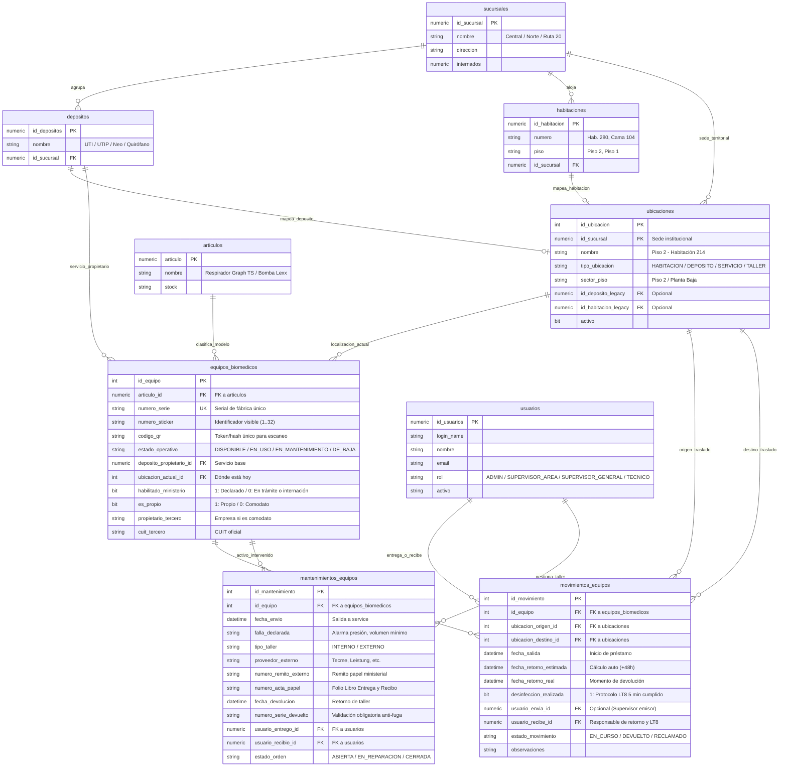

# Diagrama Entidad-Relación (DER) y Diccionario de Datos
## Gestión de Equipamiento y Trazabilidad - Clínica Privada Vélez Sarsfield

* **Proyecto:** Sistema de Gestión, Trazabilidad y Bioseguridad de Equipamiento Biomédico
* **Autor:** Martín Sciarra (Legajo 69650 - DNI 40.107.751)
* **Organización:** Clínica Privada Vélez Sarsfield (Córdoba)
* **Motor de Base de Datos:** Microsoft SQL Server (Transact-SQL)
* **Versión:** 1.0 (Diseño Lógico y Físico Normalizado)
* **Fecha:** Octubre 2026

---

## 1. Visión General de la Arquitectura de Datos

La arquitectura de datos se concibe bajo una estrategia de **extensión no invasiva**, desacoplada en dos capas complementarias para convivir armoniosamente con los sistemas preexistentes de la clínica:

```
┌────────────────────────────────────────────────────────────────────────┐
│ 1. CAPA INSTITUCIONAL LEGADA (Tablas Preexistentes de la Clínica)      │
│    • sucursales (Sede Central, Norte, Ruta 20)                         │
│    • depositos (Servicios clínicos / Talleres de scriptstock.sql)      │
│    • habitaciones (Camas y sectores de internación general)            │
│    • articulos (Catálogo maestro de modelos y marcas electromédicas)   │
│    • usuarios (Cuentas del personal institucional)                     │
└───────────────────────────────────┬────────────────────────────────────┘
                                    │ (Integración por FKs)
                                    ▼
┌────────────────────────────────────────────────────────────────────────┐
│ 2. CAPA DE TRAZABILIDAD Y BIOSEGURIDAD (Nuevas Entidades del Sistema)   │
│    • ubicaciones (Tabla unificadora de depósitos y camas de hospital)  │
│    • equipos_biomedicos (Instancias físicas serializadas con QR)       │
│    • movimientos_equipos (Historial de traslados, custodias y LT8)     │
│    • mantenimientos_equipos (Órdenes de service, remitos y control)    │
└────────────────────────────────────────────────────────────────────────┘
```

---

## 2. Diagrama Entidad-Relación Visual (Mermaid)



---

## 3. Diccionario de Datos Detallado

A continuación se detalla la estructura física de cada tabla con sus tipos de datos en **Microsoft SQL Server (T-SQL)**, restricciones y reglas de negocio:

### 3.1. Tabla `ubicaciones` (Capa Unificadora)
* **Propósito:** Resuelve la heterogeneidad entre los depósitos clínicos (`depositos`) y las camas de internación (`habitaciones`), unificando todos los destinos físicos en una sola entidad para transferencias transparentes.

| Campo | Tipo SQL | Nulo | Clave / Restricción | Descripción y Regla de Negocio |
| :--- | :--- | :---: | :---: | :--- |
| `id_ubicacion` | `INT IDENTITY(1,1)` | No | **PK** | Identificador unívoco de la ubicación. |
| `id_sucursal` | `NUMERIC(18,0)` | No | **FK** $\rightarrow$ `sucursales` | Sucursal física (Central, Norte, Ruta 20). |
| `nombre` | `VARCHAR(100)` | No | — | Denominación legible (ej. *"Piso 2 - Habitación 214"*, *"UTI Central"*). |
| `tipo_ubicacion` | `VARCHAR(20)` | No | `CHECK IN ('HABITACION', 'DEPOSITO', 'SERVICIO', 'TALLER')` | Clasificación funcional del espacio físico. |
| `sector_piso` | `VARCHAR(50)` | Sí | — | Agrupador de planta (ej. *"Piso 2"*, *"Planta Baja"*, *"Subsuelo"*). |
| `id_deposito_legacy` | `NUMERIC(18,0)` | Sí | **FK** $\rightarrow$ `depositos` | Vínculo opcional si la ubicación proviene de un depósito del sistema legado. |
| `id_habitacion_legacy`| `NUMERIC(18,0)` | Sí | **FK** $\rightarrow$ `habitaciones` | Vínculo opcional si proviene del maestro de habitaciones. |
| `activo` | `BIT` | No | `DEFAULT 1` | 1: Activo / 0: Clausurado o inhabilitado temporalmente. |

---

### 3.2. Tabla `equipos_biomedicos` (Activos Serializados)
* **Propósito:** Individualiza cada máquina física real, gestionando su criticidad, números visibles, códigos QR y condición legal ante el Ministerio de Salud.

| Campo | Tipo SQL | Nulo | Clave / Restricción | Descripción y Regla de Negocio |
| :--- | :--- | :---: | :---: | :--- |
| `id_equipo` | `INT IDENTITY(1,1)` | No | **PK** | Identificador interno de la máquina. |
| `articulo_id` | `NUMERIC(18,0)` | No | **FK** $\rightarrow$ `articulos` | Referencia al catálogo de marca y modelo institucional. |
| `numero_serie` | `VARCHAR(50)` | No | **UK** | Número de serie de fábrica. **Único e inmutable**; previene la duplicación y fugas. |
| `numero_sticker` | `VARCHAR(20)` | Sí | — | Identificador visible a simple vista (ej. **1 al 32** para bombas Lexx). |
| `codigo_qr` | `VARCHAR(64)` | No | **UK** | Token/Hash alfanumérico único para renderizado y escaneo de código QR. |
| `estado_operativo` | `VARCHAR(20)` | No | `CHECK IN ('DISPONIBLE', 'EN_USO', 'EN_MANTENIMIENTO', 'DE_BAJA')` | Estado del activo. Inicializa en `DISPONIBLE`. |
| `deposito_propietario_id`| `NUMERIC(18,0)`| No | **FK** $\rightarrow$ `depositos` | Servicio clínico dueño patrimonial (ej. UTIP, Neonatología, UTI). |
| `ubicacion_actual_id` | `INT` | No | **FK** $\rightarrow$ `ubicaciones` | Ubicación física en tiempo real (dónde está operando hoy). |
| `habilitado_ministerio`| `BIT` | No | `DEFAULT 1` | 1: Declarado oficialmente ante el Ministerio / 0: En trámite o flota internación. |
| `es_propio` | `BIT` | No | `DEFAULT 1` | 1: Activo de la clínica / 0: En comodato o alquiler de terceros. |
| `propietario_tercero` | `VARCHAR(100)` | Sí | — | Razón social de la empresa propietaria en caso de comodato. |
| `cuit_tercero` | `VARCHAR(13)` | Sí | — | CUIT oficial de la empresa para responder ante Regulación Sanitaria. |

---

### 3.3. Tabla `movimientos_equipos` (Trazabilidad y Bioseguridad)
* **Propósito:** Registra cada ciclo de préstamo inter-servicio, asignación transitoria a cama y restitución con protocolo de desinfección hospitalaria con LT8.

| Campo | Tipo SQL | Nulo | Clave / Restricción | Descripción y Regla de Negocio |
| :--- | :--- | :---: | :---: | :--- |
| `id_movimiento` | `INT IDENTITY(1,1)` | No | **PK** | Identificador del evento de custodia. |
| `id_equipo` | `INT` | No | **FK** $\rightarrow$ `equipos_biomedicos` | Máquina trasladada. |
| `ubicacion_origen_id` | `INT` | No | **FK** $\rightarrow$ `ubicaciones` | Sector o servicio desde donde sale el equipo. |
| `ubicacion_destino_id`| `INT` | No | **FK** $\rightarrow$ `ubicaciones` | Habitación, cama o servicio receptor. |
| `fecha_salida` | `DATETIME` | No | `DEFAULT GETDATE()` | Momento exacto del despacho físico. |
| `fecha_retorno_estimada`| `DATETIME` | Sí | — | Cálculo automático del sistema (`fecha_salida + 48 hs`) para alerta de retención. |
| `fecha_retorno_real` | `DATETIME` | Sí | — | Momento en que el supervisor confirma la devolución en la app. |
| `desinfeccion_realizada`| `BIT` | No | `DEFAULT 0` | **Tilde de Bioseguridad:** 1 si se cumplió el protocolo LT8 (5 min) al reingreso. |
| `usuario_envia_id` | `NUMERIC(18,0)` | Sí | **FK** $\rightarrow$ `usuarios` | Supervisor que despachó el equipo (Nullable en urgencias de piso). |
| `usuario_recibe_id` | `NUMERIC(18,0)` | Sí | **FK** $\rightarrow$ `usuarios` | **Responsable legal:** Usuario logueado que recibe y certifica la desinfección LT8. |
| `estado_movimiento` | `VARCHAR(20)` | No | `CHECK IN ('EN_CURSO', 'DEVUELTO', 'RECLAMADO')` | Ciclo del movimiento. Pasa a `DEVUELTO` al confirmar la restitución. |
| `observaciones` | `VARCHAR(255)` | Sí | — | Notas adicionales operativas de guardia. |

---

### 3.4. Tabla `mantenimientos_equipos` (Blindaje de Taller y Control Anti-Fuga)
* **Propósito:** Controla las salidas a service técnico interno o externo, digitalizando folios de libros descentralizados de guardia y validando estrictamente el número de serie al volver.

| Campo | Tipo SQL | Nulo | Clave / Restricción | Descripción y Regla de Negocio |
| :--- | :--- | :---: | :---: | :--- |
| `id_mantenimiento` | `INT IDENTITY(1,1)` | No | **PK** | Identificador de la orden de reparación. |
| `id_equipo` | `INT` | No | **FK** $\rightarrow$ `equipos_biomedicos` | Activo averiado ingresado a mantenimiento. |
| `fecha_envio` | `DATETIME` | No | `DEFAULT GETDATE()` | Fecha y hora de retiro físico por mantenimiento. |
| `falla_declarada` | `VARCHAR(255)` | No | — | Síntoma reportado (ej. *"Falla alarma presión"*, *"Error volumen mínimo"*). |
| `tipo_taller` | `VARCHAR(20)` | No | `CHECK IN ('INTERNO', 'EXTERNO')` | Ámbito de reparación (Taller de la clínica o service oficial del fabricante). |
| `proveedor_externo` | `VARCHAR(100)` | Sí | — | Nombre del taller/fabricante externo (ej. *Tecme*, *Leistung*). |
| `numero_remito_externo`| `VARCHAR(50)` | Sí | — | Número de remito en papel oficial para inspecciones del Ministerio de Salud. |
| `numero_acta_papel` | `VARCHAR(50)` | Sí | — | Folio o asiento en el **Libro de Entrega y Recibo** del servicio clínico emisor. |
| `fecha_devolucion` | `DATETIME` | Sí | — | Fecha y hora en que el equipo reingresa reparado al servicio. |
| `numero_serie_devuelto`| `VARCHAR(50)` | Sí | — | **Control Anti-Fuga:** Serial físico que ingresa. Debe coincidir con `numero_serie`. |
| `usuario_entrego_id` | `NUMERIC(18,0)` | No | **FK** $\rightarrow$ `usuarios` | Supervisor que entrega la máquina averiada. |
| `usuario_recibio_id` | `NUMERIC(18,0)` | Sí | **FK** $\rightarrow$ `usuarios` | Supervisor que verifica y recepciona el equipo devuelto. |
| `estado_orden` | `VARCHAR(20)` | No | `CHECK IN ('ABIERTA', 'EN_REPARACION', 'CERRADA')` | Ciclo de la orden técnica. |

---

### 3.5. Tabla `usuarios` (Ampliación de Perfiles)
* **Propósito:** Reutiliza la tabla de usuarios existente añadiendo el campo `rol` para gobernar los permisos de acceso y deslindar responsabilidades sin sobrecargar con logins al personal raso.

| Campo | Tipo SQL | Nulo | Descripción y Regla de Negocio |
| :--- | :--- | :---: | :--- |
| `id_usuarios` | `NUMERIC(18,0)` | No | **PK Legada** preexistente en la base de datos. |
| `login_name` | `VARCHAR(50)` | No | Nombre de usuario de acceso. |
| `nombre` | `VARCHAR(100)` | No | Nombre y apellido del profesional. |
| `rol` | `VARCHAR(30)` | No | `CHECK IN ('ADMIN', 'SUPERVISOR_AREA', 'SUPERVISOR_GENERAL', 'TECNICO')`<br>• `ADMIN`: Alejandra (Control total, auditoría y reportes).<br>• `SUPERVISOR_AREA`: Turno L-V en servicios cerrados.<br>• `SUPERVISOR_GENERAL`: Cobertura 24/7 con móvil corporativo.<br>• `TECNICO`: Personal de mantenimiento y bioingeniería. |
| `activo` | `CHAR(1)` / `BIT` | No | Estado de habilitación del usuario. |

---

## 4. Matriz de Integridad Referencial y Acciones en Cascada

| Tabla Origen (FK) | Columna FK | Tabla Destino (PK) | Columna PK | Acción al Eliminar (`ON DELETE`) |
| :--- | :--- | :--- | :--- | :---: |
| `ubicaciones` | `id_sucursal` | `sucursales` | `id_sucursal` | `NO ACTION` (Protege integridad) |
| `ubicaciones` | `id_deposito_legacy` | `depositos` | `id_depositos` | `SET NULL` |
| `ubicaciones` | `id_habitacion_legacy` | `habitaciones` | `id_habitacion` | `SET NULL` |
| `equipos_biomedicos` | `articulo_id` | `articulos` | `articulo` | `NO ACTION` |
| `equipos_biomedicos` | `deposito_propietario_id`| `depositos` | `id_depositos` | `NO ACTION` |
| `equipos_biomedicos` | `ubicacion_actual_id` | `ubicaciones` | `id_ubicacion` | `NO ACTION` |
| `movimientos_equipos`| `id_equipo` | `equipos_biomedicos` | `id_equipo` | `NO ACTION` (Historial inmutable) |
| `movimientos_equipos`| `ubicacion_origen_id` | `ubicaciones` | `id_ubicacion` | `NO ACTION` |
| `movimientos_equipos`| `ubicacion_destino_id`| `ubicaciones` | `id_ubicacion` | `NO ACTION` |
| `movimientos_equipos`| `usuario_recibe_id` | `usuarios` | `id_usuarios` | `NO ACTION` |
| `mantenimientos_equipos`| `id_equipo` | `equipos_biomedicos` | `id_equipo` | `NO ACTION` (Auditoría legal) |

---

## 5. Índices de Optimización y Rendimiento

Para asegurar que las consultas del Tablero en Vivo y los escaneos móviles respondan en menos de 2 segundos, se definen los siguientes índices:

1. **`UK_equipos_numero_serie` (UNIQUE):**  
   Garantiza que ningún aparato comparta número de serie físico en la institución.
2. **`UK_equipos_codigo_qr` (UNIQUE):**  
   Permite la resolución instantánea del equipo al escanear el código QR con la cámara móvil.
3. **`IX_equipos_ubicacion_actual` (NON-CLUSTERED):**  
   Optimiza el agrupamiento por servicio y cama en el Dashboard principal.
4. **`IX_movimientos_equipo_fecha` (NON-CLUSTERED):**  
   Acelera la búsqueda de los últimos movimientos de un equipo y el cálculo de la alerta de permanencia (+48 hs).
5. **`IX_mantenimientos_estado_fecha` (NON-CLUSTERED):**  
   Optimiza el cálculo en tiempo real del semáforo de días de demora en taller.
