# Análisis Hipotético: Optimización del Circuito y Prevención de Fuga a Excel

> [!IMPORTANT]
> **Propósito del Documento:**  
> Este es un análisis **hipotético y estratégico**. No modifica la documentación oficial ni la propuesta técnica de la PPS. Su objetivo es evaluar la frontera entre **control estricto** y **fricción operativa**, identificando exactamente qué pasos deben **omitirse o automatizarse** para que el personal de enfermería y supervisión adopte el sistema y no termine abandonándolo para volver a planillas de Excel o cuadernos manuales.

---

## 1. El Diagnóstico del "Síndrome de Rechazo al Software"

En entornos de salud críticos (urgencias, terapias, internado general), los sistemas informáticos suelen fracasar por dos motivos esenciales:
1. **Fricción en el momento de la urgencia:** Si el software exige trámites antes de poder usar un aparato con un paciente en paro o shock, el personal toma el aparato sin registrarlo.
2. **Exceso de clics y estados intermedios:** Cuando un proceso administrativo requiere más pasos de los que demandaba anotar en un papel o enviar un audio por WhatsApp, el usuario percibe el sistema como un "estorbo burocrático" y recurre al atajo informal (Excel paralelo, llamada o cuaderno de guardia).

---

## 2. Diagrama del Circuito Completo y Puntos Críticos a Omitir

El siguiente diagrama modela el **circuito completo de punta a punta**, destacando con formato punteado y flechas de corte (**✂️ OMITIR / AUTOMATIZAR**) aquellos pasos teóricos que añaden burocracia destructiva y que deben eliminarse de la aplicación web:

```mermaid
flowchart TD
    classDef esencial fill:#e8f5e9,stroke:#2e7d32,stroke-width:2px,color:#1b5e20;
    classDef omitir fill:#ffebee,stroke:#c62828,stroke-width:2px,stroke-dasharray: 5 5,color:#b71c1c;
    classDef alerta fill:#fff3e0,stroke:#ef6c00,stroke-width:2px,color:#e65100;
    classDef corte fill:#f3e5f5,stroke:#7b1fa2,stroke-width:2px,color:#4a148c;

    subgraph FASE_1["1. GENERACIÓN DE NECESIDAD"]
        A["Paciente en Sala/Quirófano requiere Bomba o Respirador"]:::esencial
        B["Solicitud formal previa en software con aprobación médica"]:::omitir
        C1{"¿Cómo se resuelve?"}:::corte
    end

    A --> B
    B -->|✂️ OMITIR: Frena la urgencia médica| C1
    A -->|Ruta Directa Ágil| C1

    subgraph FASE_2["2. DESPACHO Y PRÉSTAMO"]
        C1 --> C["Enfermero/Camillero retira equipo físicamente de UTI/Neo"]:::esencial
        D["Ingreso de HC, Cama, Patología y DNI del Paciente en Web"]:::omitir
        E["Registro Ágil: Solo N° Equipo (1..32) y Servicio Destino"]:::esencial
    end

    C --> D
    D -->|✂️ OMITIR: Enfermería no carga datos clínicos en inventario| E
    C -->|Registro en 2 Clics| E

    subgraph FASE_3["3. USO EN INTERNACIÓN Y MONITOREO"]
        E --> F["Equipo en uso en Habitación / Servicio Receptor"]:::esencial
        G["Check-in diario de inventario por enfermera de sala"]:::omitir
        H["Censo Visual Pasivo por Supervisión General en sus rondas"]:::esencial
    end

    F --> G
    G -->|✂️ OMITIR: Carga burocrática sin valor agregado| H
    F -->|Supervisión Centralizada| H

    subgraph FASE_4["4. LIBERACIÓN Y BIOSEGURIDAD"]
        H --> I["Paciente desocupó el equipo (Alta o Fin de infusión)"]:::esencial
        J["Paso a estado 'EN_DESINFECCION' (Espera de 5 min)"]:::omitir
        K["Protocolo Físico LT8 en sala (5 min)"]:::esencial
        L["Checkbox 'Desinfección LT8 realizada' al confirmar retorno"]:::esencial
    end

    I --> J
    J -->|✂️ OMITIR: Queda en el limbo si olvidan el segundo clic| K
    I -->|Acción Inmediata| K
    K --> L

    subgraph FASE_5["5. RESTITUCIÓN AL SERVICIO BASE"]
        L --> M["Doble firma: Remito digital de salida y recibo de entrada"]:::omitir
        N["1 Clic de Supervisión: Equipo pasa a DISPONIBLE"]:::esencial
    end

    L --> M
    M -->|✂️ OMITIR: Duplicación innecesaria de validación| N
    L -->|Cierre Inmediato| N

    subgraph FASE_6["6. SALIDA A MANTENIMIENTO TALLER"]
        N -.->|Falla o Service| O["Detección de Falla Técnica"]:::alerta
        O --> P["Generación de Orden de Trabajo con 10 campos técnicos"]:::omitir
        Q["Registro Express: N° Equipo + Falla Breve + N° Remito"]:::esencial
    end

    O --> P
    P -->|✂️ OMITIR: El supervisor no es bioingeniero| Q
    O -->|Mínima Fricción| Q
```

---

## 3. Matriz de Cirugía Burocrática: Qué Omitir y Por Qué

| Etapa del Circuito | Paso Burocrático Teórico | ⚠️ Riesgo de Rechazo (Vuelta a Excel) | ✂️ Acción: Qué se Omite o Simplifica | ✅ Solución Ágil en la Web |
| :--- | :--- | :--- | :--- | :--- |
| **1. Solicitud de Equipo** | Pedido formal previo en pantalla antes de ir a buscar la bomba. | **Altísimo.** En una urgencia nadie entra a una PC a pedir permiso; se llevan la bomba y el sistema queda desfasado desde el minuto cero. | **OMITIR la solicitud previa.** El registro se hace cuando el equipo *ya se retira* físicamente. | Flujo directo de *Despacho en 1 paso* por parte de quien entrega o de supervisión. |
| **2. Datos de Asignación** | Exigir Historia Clínica (HC), DNI, nombre de paciente y diagnóstico médico. | **Muy Alto.** La enfermera no quiere ni debe cargar datos médicos en un sistema de activo fijo. Desiste tras el segundo intento. | **OMITIR vinculación obligatoria con paciente.** Al inventario le importa la **ubicación física**, no la HC. | Selector rápido: `Equipo: 14` $\rightarrow$ `Destino: Sala 3 / Hab 204`. Tiempo: **4 segundos**. |
| **3. Cuentas de Usuario de Piso** | Forzar a cada enfermero de sala a tener usuario, contraseña e iniciar sesión para recibir. | **Extremo.** Olvido de claves, cambio de turnos de 8 horas, computadoras compartidas sin loguear. | **OMITIR login de enfermeros rasos.** | Toda la carga operativa recae en **Supervisores de Área (mañana/tarde)** y **Supervisión General (24/7)** con su dispositivo corporativo. |
| **4. Desinfección Hospitalaria** | Crear un estado intermedio `EN_DESINFECCION` que requiera volver a la PC a habilitarlo tras 5 minutos. | **Garantizado.** El personal higieniza la bomba, se va a atender un paciente y nunca más vuelve a la PC a cambiar el estado. El equipo queda "muerto" en pantalla. | **OMITIR estado intermedio.** No reflejar tiempos muertos de menos de 15 minutos en la base de datos. | **Checkbox obligatorio `[✓] LT8 cumplido`** en el mismo momento del reingreso. Pasa directo a `DISPONIBLE`. |
| **5. Devolución / Doble Remito** | Sistema de "doble confirmación": el emisor declara que devuelve y el receptor acepta. | **Medio-Alto.** El emisor lo manda con el camillero y no avisa en la app; queda en estado "En Tránsito" eternamente. | **OMITIR doble confirmación.** | La Supervisión General o de Área que recibe la bomba en la base escanea/tipea el número y **toma posesión con 1 solo clic**. |
| **6. Taller / Service Externo** | Formularios extensos de descripción electromédica, calibraciones y presupuestos. | **Alto.** El supervisor anota el remito en un cuaderno porque la app le pide campos que desconoce. | **OMITIR campos técnicos complejos.** | Tres datos únicos: `Equipo`, `Falla declarada (texto libre)`, `N° Remito papel`. Validación estricta solo del **Serial** al volver. |

---

## 4. Las 4 "Leyes de Hierro" para que la Clínica No Vuelva a Excel

> [!TIP]
> Si el diseño de la aplicación respeta estas cuatro reglas, el equipo médico sentirá que la app les **resuelve problemas** en lugar de sumarles trabajo:

1. **Regla de los 3 Clics o Menos de 10 Segundos:**  
   Cualquier movimiento de equipamiento (préstamo, devolución o envío a taller) debe completarse en máximo **3 interacciones** y tomar menos de **10 segundos**. Si lleva más tiempo, volverán al WhatsApp o al Excel.
2. **Asincronía Tolerada (La Urgencia Manda):**  
   Si una bomba se traslada a las 03:00 AM en medio de una emergencia quirúrgica, el sistema debe permitir que la Supervisión General regularice el movimiento a las 03:20 AM sin penalizaciones, bloqueos ni errores de correlatividad.
3. **Trazabilidad por Ubicación, No por Paciente:**  
   El objetivo del proyecto es responder: *«¿Dónde está físicamente la bomba número 12?»* (ej. *Cama 208* o *Neo*), no hacer gestión de historia clínica. Separar tajantemente el inventario biomédico del sistema médico-asistencial.
4. **Cero Pantallas en Blanco:**  
   Evitar formularios donde haya que escribir manualmente nombres de servicios o modelos. Todo debe resolverse con listas desplegables filtradas (`UTI`, `Piso 2`, `Quirófano`), botones gigantes táctiles (aptos para celular corporativo) o escaneo rápido de sticker/QR.
